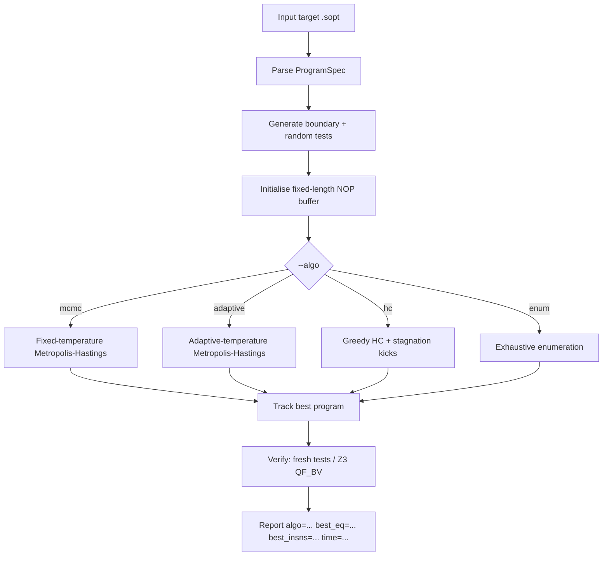
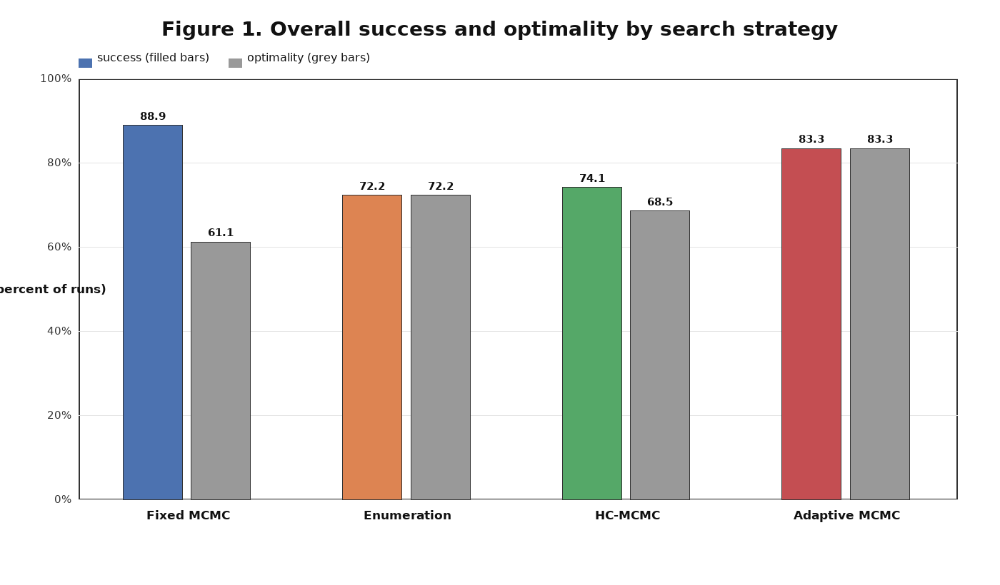
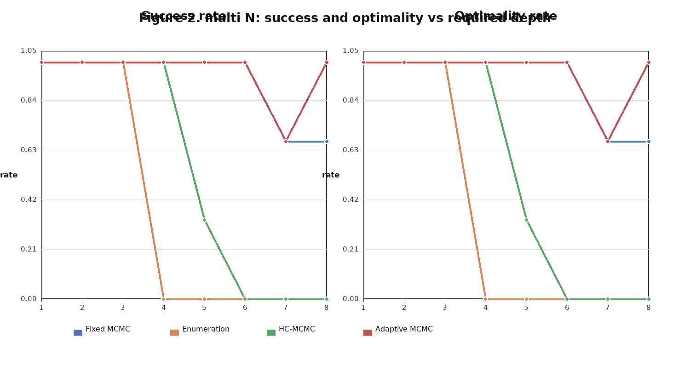
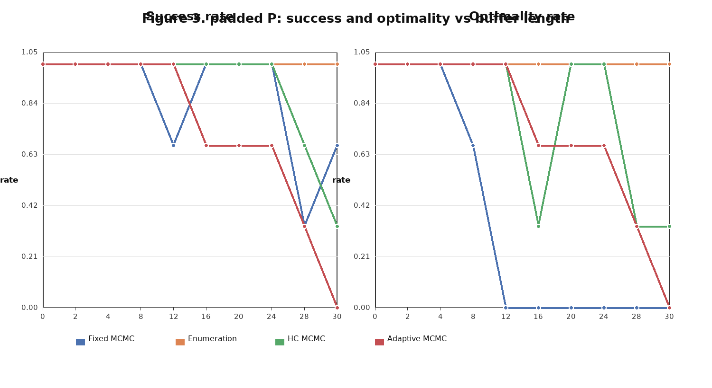
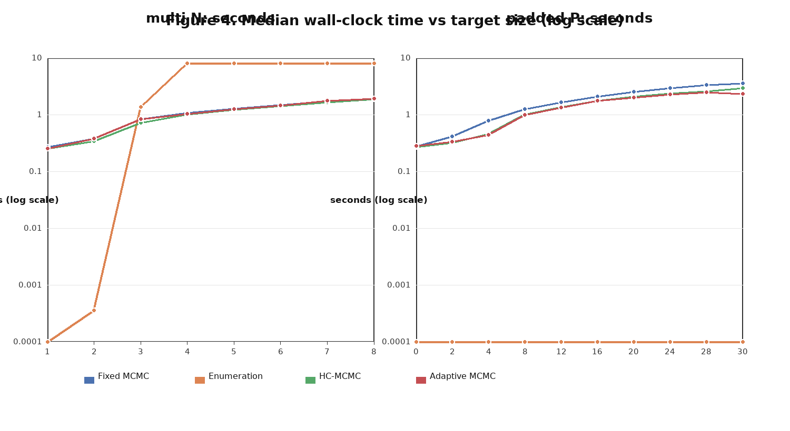

# Review 3: A Regression-Guided STOKE-Style Superoptimizer for a Reduced RV32I ISA

**Project:** Superoptimizer (`super-optimizer`)  
**Implementation:** C++17, plain Makefile, optional Z3 verifier  
**Evaluation:** 18 synthetic targets with provable optima, 300,000 MCMC iterations, 3 seeds

---

## 1. Abstract

### 1.1 Project description

This project implements a STOKE-style superoptimizer for a loop-free,
register-only subset of RV32I [12]. Given a target basic block and a live-in/live-out
interface, the tool searches for a shorter instruction sequence that produces
the same live-out values for all inputs. The cost function combines a graded
correctness distance with an instruction/performance penalty, and search is
driven by Metropolis–Hastings MCMC over fixed-length NOP-padded program
buffers. The implementation includes an interpreter, test generator, mutator,
enumerative search, optional Z3 verification, learned and analytical cost
models, a C-like expression frontend, and a benchmark harness for comparing
search strategies.

The central question of this review is *which search strategy should be used,
and when*. Fixed-temperature MCMC is the base-paper algorithm. The proposed
framework adds adaptive-temperature MCMC, HC-MCMC (greedy hill climbing with
stagnation kicks), and standalone enumerative search, all selected with
`--algo`. The benchmark shows that no single strategy dominates: enumeration
wins on shallow solutions, HC-MCMC wins at required depth 3 and on some long
shallow buffers, and adaptive MCMC wins on deep solutions.

### 1.2 Base-paper algorithms used and their accuracy

The base paper is Schkufza, Sharma, and Aiken, *Stochastic Superoptimization*
(ASPLOS 2013) [3]. Its main algorithm is fixed-temperature Metropolis–Hastings
MCMC with a graded correctness term:

```text
π(P) ∝ exp(−β · cost(P))
accept P' with probability min(1, exp(−β · (cost(P') − cost(P))))
```

The paper reports correctness-verified optimizations and speedups over
compiler-generated code rather than a single classification accuracy, because
the search is stochastic. To make accuracy concrete and reproducible, this
review uses the same protocol as the proposed methods:

- **Success:** a correct program is found (`best_eq = 0`).
- **Optimality:** a correct program with the known optimal instruction count is
  found (`best_eq = 0` and `best_insns = opt`).

Under that protocol, the base-paper fixed-temperature MCMC, as implemented in
this repository, achieves **88.9% success and 61.1% optimality** over all 18
targets and 54 runs. It is strong on deep `multi N` targets (91.7%/91.7%) but
weak on long `padded P` targets (86.7% success, 36.7% optimality). The
repository's enumerative baseline, which follows the exact search tradition of
Bansal–Aiken [2] and Gulwani et al. [10], is exact but exponential; in this
project it is exact for shallow optima and times out at required depth 4.

### 1.3 Proposed-method algorithms used and their accuracy

The proposed framework keeps the same cost function, interpreter, and mutator,
and changes the search policy. Three strategies are exposed and are always run
separately, never chained in one process:

| Strategy | Algorithm | Success | Optimality |
|---|---|---:|---:|
| `--algo adaptive` | Metropolis–Hastings with online inverse-temperature adaptation | 83.3% | 83.3% |
| `--algo hc` | Greedy hill climbing (`Δ ≤ 0`) + stagnation-triggered kicks | 74.1% | 68.5% |
| `--algo enum` | Exhaustive enumeration with a hard length cap | 72.2%* | 72.2%* |

\* Enumeration was run once per target and has 8s timeout. Its overall figure
includes timeouts as failures; whenever the optimum length is within the cap, it
is exact. On `padded P` it is **100%** successful and optimal; on `multi N` it
fails at `N ≥ 4` because of the exponential search space and the length-4 cap.

On the deep `multi N` family, adaptive MCMC reaches **95.8% success and 95.8%
optimality**, compared with 54.2% for HC-MCMC and 37.5% for enumeration
(including timeouts). On the long `padded P` family, HC-MCMC reaches **90.0%
success and 80.0% optimality**, while adaptive MCMC reaches 73.3%/73.3%. These
opposite results are the main empirical finding of the project.

### 1.4 New features added

Relative to the base-paper fixed-temperature MCMC baseline, the framework adds:

- **Adaptive MCMC** (`--algo adaptive`): β is updated every
  `--adapt-window` proposals from the observed acceptance rate toward
  `--target-accept` (default 0.234), removing manual β tuning.
- **HC-MCMC** (`--algo hc`): greedy acceptance of non-worsening moves, with a
  kick from the incumbent best after `--hc-stall` stagnant iterations.
- **Standalone enumerative search** (`--algo enum`): uses `enumerate_search()`
  as the search itself, not only as a post-MCMC baseline.
- **Unified strategy interface:** `--algo mcmc|adaptive|hc|enum`; the result
  line reports the strategy with an `algo=` prefix.
- **Benchmark harness** (`tools/benchmark_search.py`, `make bench-search`):
  generates targets with provable optima and reports success, optimality,
  median time, and breaking points.
- **Reproducible raw results:** `results/search_benchmark.csv` for the three
  proposed strategies and `results/search_benchmark_mcmc.csv` for the base
  baseline.
- **Framework features beyond the base algorithm:** Z3 `QF_BV` verification,
  static/dynamic cycle cost modes, a gradient-boosted cost model, multi-chain
  search, and a C-like expression frontend.

---

## 2. Introduction

Superoptimization asks for the cheapest program equivalent to a given target.
For loop-free register-only blocks the equivalence question is decidable, but
the search space is enormous: a length-`ℓ` program over `R` registers and
immediate pool `I` has roughly `Θ(B^ℓ)` possibilities, where `B` is the
per-slot branching factor. Exhaustive enumeration is exact but scales
exponentially with the length of the *solution*. Random-walk search scales with
the number of iterations and the length of the *buffer*, but it can get trapped
in local minima and is sensitive to its temperature parameter.

The base paper [3] addresses this with a graded cost function and MCMC:
programs that are "almost correct" receive partial credit, so the search is
guided toward correct programs instead of relying on random discovery.
However, a fixed β that works for one target can be too hot or too cold for
another. The proposed framework explores three complementary policies:

1. adapt β online so the acceptance rate stays near a target;
2. use greedy hill climbing with random kicks for fast descent and local escape;
3. use exact enumeration when the solution is short.

The benchmark is designed so that the optimal instruction count is known by
construction. This avoids ground-truth uncertainty and lets us state precisely
where each strategy wins.

### 2.1 Overall project layout

```text
super-optimizer/
├── architecture.md              formal design and target specification
├── Makefile                     build, benchmark, model targets
├── src/
│   ├── main.cpp                 CLI, target loading, frontend dispatch
│   ├── parser.cpp               .sopt parser
│   ├── interpreter.cpp          bit-exact RV32I subset execution
│   ├── testgen.cpp              boundary + random test generation
│   ├── cost.cpp                 graded correctness + perf cost
│   ├── mutator.cpp              symmetric proposal moves
│   ├── mcmc.cpp                 fixed MCMC, adaptive MCMC, HC-MCMC
│   ├── enumerate.cpp            enumerative search
│   ├── verify.cpp               Z3 / probabilistic verification
│   ├── sim.cpp                  DAG, list scheduling, Tomasulo model
│   ├── features.cpp             feature extraction for learned cost
│   └── model_data.hpp           exported regression trees
├── bench/toy/*.sopt             20 hand-written toy targets
├── tools/
│   ├── benchmark_search.py      provable-optimum strategy benchmark
│   ├── gen_dataset.cpp          cost-model dataset generator
│   └── train_model.py           gradient-boosted tree trainer
├── results/
│   ├── search_benchmark.csv     enum / adaptive / hc raw runs
│   └── search_benchmark_mcmc.csv fixed-MCMC baseline raw runs
├── docs/                        design, math, running, benchmark docs
└── superopt                     built executable
```

The data flow is: parse target → generate tests → initialise fixed-length
buffer → propose a mutation → score candidate → accept/reject according to the
selected strategy → track best → verify → report.

### 2.2 Major contributions of the proposed framework

1. **Adaptive search without per-target β tuning.** The acceptance-rate
   controller adjusts β in log space and clamps it to `[10^-3, 10^3]`.
2. **A second, complementary escape mechanism.** HC-MCMC accepts only
   non-worsening moves but kicks the incumbent best after stagnation, giving a
   fast iterated-local-search behaviour.
3. **An exact fallback for short solutions.** Standalone enumeration is exposed
   as a first-class strategy, not merely a debugging baseline.
4. **A benchmark with provable optima.** Two synthetic families isolate
   solution depth (`multi N`) and buffer length (`padded P`), producing
   reproducible breaking points instead of anecdotal comparisons.
5. **A unified, scriptable output format.** Every run reports `algo=`,
   `best_cost=`, `best_eq=`, `best_perf=`, `best_insns=`, and `time=`.
6. **Practical guidance.** The measured crossover yields a decision guide:
   enumeration for shallow solutions, HC at depth 3, adaptive MCMC at depth ≥5.

---

## 3. Literature survey

### a. Theory

**Superoptimization.** Massalin [1] introduced superoptimization as exhaustive
search for the shortest equivalent instruction sequence. Bansal and Aiken [2]
made peephole superoptimization practical by enumerating short windows and
using pruning. Gulwani et al. [10] formulated loop-free program synthesis as a
component-based search problem. The common limitation is combinatorial growth
in the number of instructions and components.

**Stochastic search.** Metropolis et al. [4] and Hastings [5] define the
Metropolis–Hastings acceptance rule. Simulated annealing [6] gradually lowers a
temperature to trade exploration for exploitation. STOKE [3] applies a fixed
temperature to superoptimization with a graded correctness distance:

```text
cost(P) = w_c · eq(P) + w_p · perf(P)
```

where `eq(P)` is a Hamming distance over live-out bits and `perf(P)` is an
instruction or cycle cost. Because the moves are symmetric, the Hastings ratio
is 1 and the simple Metropolis rule is exact.

**Adaptive MCMC.** Haario et al. [7] and Andrieu and Thoms [8] study adaptation
of proposal or temperature parameters. A standard stochastic-approximation
update in log space is:

```text
log β_{j+1} = log β_j + g · (a_j − a*)
```

where `a_j` is the observed acceptance rate in window `j` and `a*` is the
target. Constant-gain adaptation is practical but does not by itself guarantee
exact stationarity; the implementation clamps β to keep it bounded.

**Hill climbing and iterated local search.** Greedy descent accepts only
non-worsening moves. Iterated local search [9] adds perturbations to escape
local minima. HC-MCMC is the `β → ∞` limit of Metropolis acceptance with a
stagnation-triggered perturbation.

**Verification.** Test-based scoring is probabilistic. Z3 [11] provides exact
`QF_BV` equivalence checking; the project uses a counterexample-guided loop when
Z3 is available and reports "probabilistically verified" otherwise.

### b. Comparative table

| Approach | Representative work | Key idea | Strength | Main limitation |
|---|---|---|---|---|
| Enumerative superoptimization | Massalin [1]; Bansal & Aiken [2]; Gulwani et al. [10] | Enumerate short programs; prune dead writes | Exact; simple; no tuning | Exponential in solution length |
| Stochastic superoptimization | Schkufza et al. [3] | MCMC over NOP-padded buffers with graded correctness | Finds deep solutions; anytime | Fixed β; local minima; random-walk scaling |
| Simulated annealing | Kirkpatrick et al. [6] | Temperature schedule | Escapes local minima early | Schedule tuning; no exactness |
| Adaptive MCMC | Haario et al. [7]; Andrieu & Thoms [8] | Adapt β or proposal from acceptance rate | Less manual tuning | Constant gain is not exact stationarity |
| Hill climbing / ILS | Lourenço et al. [9] | Greedy descent + perturbation/kick | Fast on easy targets | Greedy bias; local minima |
| SMT-based equivalence | de Moura & Bjørner [11] | Bit-vector encoding; unsat proof | Exact verification | Solver cost; not a search policy |
| Learned cost models | Mendis et al. [13] | Predict throughput from block features | Fast approximate cost | Distribution shift; training data |
| LLM-guided synthesis | Wei et al. [15] | Language model proposes programs | Broad prior knowledge | Correctness and reproducibility risks |

### c. Limitations of the existing methods

- **Fixed-temperature MCMC** needs a target-specific β. A low β explores but
  may not settle; a high β converges quickly but gets stuck. Our baseline shows
  this directly: it reaches only 36.7% optimality on long padded targets even
  though it reaches 91.7% on `multi N`.
- **Pure enumeration** is exact but cannot reach required depth 4 within an 8s
  timeout on this hardware, and its cost grows as `Θ(B^ℓ)`.
- **Greedy hill climbing** is fast but myopic; without kicks it freezes on the
  first local minimum. With kicks it still loses to adaptive MCMC at depth ≥5.
- **Random-walk MCMC** degrades as the buffer grows even when the optimum stays
  short: at `padded P = 30`, adaptive MCMC succeeds on 0/3 seeds and HC-MCMC on
  1/3, while enumeration is still exact at ~0s.
- **Test-based correctness** is probabilistic unless Z3 is enabled. The
  reported `best_eq = 0` means "passed the search tests", not a proof.
- **Scope limitations:** the ISA excludes memory, branches, multiplication, and
  floating point; the benchmark targets are synthetic and small. The results
  should not be extrapolated to full compiler optimization without further
  validation.

---

## 4. Dataset description and sample data

### a. Link of the data

All data are local to the repository:

- Toy targets: [`../bench/toy/`](../bench/toy/)
- Generated benchmark targets and raw CSV: [`../results/search_benchmark.csv`](../results/search_benchmark.csv)
- Fixed-MCMC baseline CSV: [`../results/search_benchmark_mcmc.csv`](../results/search_benchmark_mcmc.csv)
- Benchmark generator: [`../tools/benchmark_search.py`](../tools/benchmark_search.py)
- Documentation and figures: [`benchmark.md`](benchmark.md), [`figures/`](figures/)

### b. Dataset description

The evaluation set contains **18 generated `.sopt` targets** with provable
optima, split into two families:

| Family | Sizes | Targets | Optimum | Purpose |
|---|---|---:|---|---|
| `multi N` | N = 1…8 | 8 | exactly N instructions | isolate required search depth |
| `padded P` | P = 0,2,4,8,12,16,20,24,28,30 | 10 | exactly 1 instruction | isolate buffer/target length |

Each MCMC strategy is run with 3 seeds, producing 54 runs per strategy. The
three proposed strategies therefore contribute 18 enumeration runs, 54 adaptive
runs, and 54 HC runs. The fixed-MCMC baseline contributes 54 runs. The raw CSV
has one row per run with:

```text
family,size,opt,algo,seed,status,best_eq,best_insns,time
```

`status=ok` means the run completed and printed a parseable result;
`status=timeout` means enumeration exceeded its wall-clock limit. Success and
optimality are computed from `best_eq` and `best_insns` as defined in §1.2.

The separate `bench/toy/` set contains 20 hand-written targets (for example
`smoke.sopt`, `divergence.sopt`, `demorgan.sopt`, `longchain.sopt`), several of
them based on idioms from Hacker's Delight [14]. They are used for functional
smoke tests, regression checks, and qualitative examples, but not to compute the
accuracy figures in §6.

### c. Sample data

**Sample 1 — `multi3.sopt`.** Three independent live-outs, each doubled. Any
correct program needs three writes, so the optimum is exactly 3 instructions.

```text
live_in: {a0, a1, a2}
live_out: {a0, a1, a2}
code:
slli a0, a0, 1
slli a1, a1, 1
slli a2, a2, 1
```

**Sample 2 — `padded4.sopt`.** Four identity gadgets on `t0`, followed by one
real instruction. The gadgets cancel, so the optimum is 1 instruction even
though the target has 5 instructions.

```text
live_in: {a0, a1}
live_out: {a0}
code:
add  t0, a0, a1
sub  t0, t0, a1
xor  t0, a0, a1
xor  t0, t0, a1
add  a0, t0, t0
```

**Sample 3 — raw result rows.** Enumeration is deterministic and very fast when
the optimum is short; MCMC runs are stochastic and timed per seed.

```text
family,size,opt,algo,seed,status,best_eq,best_insns,time
multi,1,1,enum,,ok,0,1,7.058e-06
multi,1,1,adaptive,1,ok,0,1,0.253196
multi,1,1,adaptive,2,ok,0,1,0.2581
multi,1,1,adaptive,3,ok,0,1,0.246922
```

For enumeration, `seed` is empty because the search is deterministic. For MCMC,
each seed is a separate trajectory, and the reported table uses the success rate
over seeds and the median wall-clock time.

---

## 5. Methodology

### a. Steps involved

1. Parse the target `.sopt` file and build a `ProgramSpec` (live-ins, live-outs,
   allowed temporaries, target instructions).
2. Generate boundary and random test cases; record target live-out values.
3. Initialise a fixed-length NOP-filled candidate buffer.
4. Score candidates with `cost = 1000·eq + perf`.
5. Propose a mutation: opcode change, operand change, swap, or full replacement.
6. Accept or reject according to the selected strategy.
7. Track the lowest-cost program ever visited.
8. Verify the best candidate on fresh tests and, when enabled, with Z3.
9. Report `algo`, cost, correctness distance, instruction count, and runtime.
10. For the benchmark, repeat with multiple seeds, aggregate success/optimality,
    and compute breaking points.

### b. Steps detailed description

**Target and tests.** The parser accepts `xN`, ABI names, or numeric registers.
The first test cases use boundary values (`0, 1, -1, INT_MIN, INT_MAX,
0x55555555, 0xAAAAAAAA, 31`) and the rest use random 32-bit values. Registers
that are neither live-in nor live-out are initialised to random constants, so
reading an uninitialised register is observable.

**Cost function.**

```text
eq(P)   = Σ_t Σ_{r ∈ live_out} popcount( P_t[r] XOR target_t[r] )
perf(P) = instruction count (default), or a cycle estimate
cost(P) = 1000 · eq(P) + perf(P)
```

Because the correctness weight is 1000 and a realistic buffer has fewer than
1000 instructions, the global minimum of the cost is always a correct program
with the fewest instructions among those visited.

**Proposal moves.** The mutator keeps the buffer length fixed and uses NOP as
the empty slot. Every move is symmetric:

1. change opcode to another opcode of the same format;
2. change one operand from the register or immediate pool;
3. swap two slots;
4. replace a slot with a random instruction (10% NOP).

**Fixed-temperature MCMC (base).**

```text
Δ = cost(candidate) − cost(current)
accept if Δ ≤ 0, otherwise accept with probability exp(−β·Δ)
```

**Adaptive MCMC (proposed).** The proposal stream and acceptance rule are
unchanged; only β changes. Every window of `W = 200` proposals:

```text
a_j = accepted proposals in window j / W
β ← clamp( β · exp( g · (a_j − a*) ), β_min, β_max )
```

Defaults: `a* = 0.234`, `g = 1.0`, `β ∈ [10^-3, 10^3]`. If the chain accepts
too much, β rises and the walk becomes greedier; if it rejects too much, β falls
and exploration increases.

**HC-MCMC (proposed).** Accept a candidate iff `cost(candidate) ≤ cost(current)`.
Equal-cost moves are allowed so the walk can traverse plateaus. After
`S = 1000` iterations without a new best:

```text
current ← best
repeat K = 4 times: current ← mutate(current)
```

The kick is accepted unconditionally and greedy descent resumes. This is an
iterated-local-search hybrid, not a sampler.

**Enumeration (proposed).** Enumerate programs of length `ℓ = 0, 1, …, L_max`
(`L_max ≤ 4`). Prune dead writes, canonicalise commutative operands, and test
survivors. The search is exact within the cap; time grows with `B^ℓ`.

**Benchmark protocol.** Each strategy is run as a separate process. MCMC uses
`--iters 300000 --beta 2.0 --seed 1..3`; enumeration uses `--enum-max-len 4`
with an 8s timeout. Success is `best_eq = 0`; optimality additionally requires
`best_insns = opt`. Timing is the median over seeds. The fixed-MCMC baseline
uses the same budget and seeds.

### c. Flowchart



---

## 6. Results and discussions

### 6.1 Accuracy by strategy

Table 1 reports success and optimality over all runs. Enumeration is
deterministic and has one run per target; its multi-depth failures are timeouts
at `N ≥ 4`. Adaptive MCMC has the best overall optimality, while HC-MCMC has the
best success rate on the padded family.

**Table 1. Aggregate accuracy over the 18 targets.**

| Strategy | multi N success / optimality | padded P success / optimality | Overall success / optimality |
|---|---:|---:|---:|
| Fixed MCMC (base) | 91.7% / 91.7% | 86.7% / 36.7% | 88.9% / 61.1% |
| Enumeration | 37.5% / 37.5%* | 100.0% / 100.0% | 72.2% / 72.2%* |
| HC-MCMC | 54.2% / 54.2% | 90.0% / 80.0% | 74.1% / 68.5% |
| Adaptive MCMC | **95.8% / 95.8%** | 73.3% / 73.3% | 83.3% / **83.3%** |

\* Includes enumeration timeouts as failures. Among completed multi runs,
enumeration is 3/3 optimal for `N = 1,2,3`.



**Figure 1** shows the same aggregate comparison visually. The base MCMC is
competitive on success but loses optimality on long padded targets. Adaptive
MCMC is the most balanced on optimality; HC-MCMC is the strongest on the padded
family; enumeration is either exact or intractable.

### 6.2 Required depth (`multi N`)

Table 2 shows optimality as the fraction of seeds that reach the known optimum.
This family isolates solution depth: for `multi N`, any correct program needs
exactly `N` writes.

**Table 2. Optimality vs required depth (`multi N`).**

| N | Fixed MCMC | Enumeration | HC-MCMC | Adaptive MCMC |
|---:|---:|---:|---:|---:|
| 1 | 3/3 | 1/1 | 3/3 | 3/3 |
| 2 | 3/3 | 1/1 | 3/3 | 3/3 |
| 3 | 3/3 | 1/1 | 3/3 | 3/3 |
| 4 | 3/3 | 0/1 (timeout) | 3/3 | 3/3 |
| 5 | 3/3 | 0/1 (timeout) | 1/3 | **3/3** |
| 6 | 3/3 | 0/1 (timeout) | 0/3 | **3/3** |
| 7 | 2/3 | 0/1 (timeout) | 0/3 | **2/3** |
| 8 | 2/3 | 0/1 (timeout) | 0/3 | **3/3** |



**Figure 2** plots success and optimality against `N`. The enumeration curve
drops to zero at `N = 4`; HC-MCMC starts collapsing at `N = 5`; adaptive MCMC
remains at or above 2/3 through `N = 8`. The fixed baseline also degrades at
`N = 7–8`, but less sharply than HC.

### 6.3 Buffer length (`padded P`)

Table 3 isolates buffer length. The target grows with `P`, but the optimum
stays at 1 instruction. Enumeration is unaffected because it stops at the first
correct length-1 program; MCMC must search a longer buffer.

**Table 3. Success / optimality vs buffer length (`padded P`; optimum = 1).**

| P | Fixed MCMC | Enumeration | HC-MCMC | Adaptive MCMC |
|---:|---:|---:|---:|---:|
| 0 | 3/3, 3/3 | 1/1, 1/1 | 3/3, 3/3 | 3/3, 3/3 |
| 2 | 3/3, 3/3 | 1/1, 1/1 | 3/3, 3/3 | 3/3, 3/3 |
| 4 | 3/3, 3/3 | 1/1, 1/1 | 3/3, 3/3 | 3/3, 3/3 |
| 8 | 3/3, 2/3 | 1/1, 1/1 | 3/3, 3/3 | 3/3, 3/3 |
| 12 | 2/3, 0/3 | 1/1, 1/1 | 3/3, 3/3 | 3/3, 3/3 |
| 16 | 3/3, 0/3 | 1/1, 1/1 | 3/3, 1/3 | 2/3, 2/3 |
| 20 | 3/3, 0/3 | 1/1, 1/1 | **3/3, 3/3** | 2/3, 2/3 |
| 24 | 3/3, 0/3 | 1/1, 1/1 | **3/3, 3/3** | 2/3, 2/3 |
| 28 | 1/3, 0/3 | 1/1, 1/1 | 2/3, 1/3 | 1/3, 1/3 |
| 30 | 2/3, 0/3 | 1/1, 1/1 | 1/3, 1/3 | 0/3, 0/3 |



**Figure 3** shows the opposite breaking point. Enumeration remains exactly
optimal at every `P`; adaptive MCMC loses optimality from `P = 16`; HC-MCMC
stays optimal through `P = 24` and then degrades; the fixed baseline reaches
correct programs but almost never the 1-instruction optimum once `P ≥ 12`.
This is the clearest evidence that buffer length, not just solution depth,
matters.

### 6.4 Runtime comparison

Table 4 reports median wall-clock time for representative targets. MCMC time is
roughly linear in the buffer/target length; enumeration time is negligible for
shallow optima and hits the 8s timeout once the required length exceeds the cap.
The full runtime curves are in Figure 4.

**Table 4. Median runtime (seconds) for representative targets.**

| Target | Fixed MCMC | Enumeration | HC-MCMC | Adaptive MCMC |
|---|---:|---:|---:|---:|
| `multi 3` | 0.832 | 1.361 | **0.717** | 0.830 |
| `multi 4` | 1.067 | 8.000 (timeout) | **1.009** | 1.043 |
| `multi 5` | 1.272 | 8.000 (timeout) | **1.225** | 1.252 |
| `multi 8` | 1.897 | 8.000 (timeout) | **1.865** | 1.905 |
| `padded 12` | 1.665 | **0.000** | 1.377 | 1.347 |
| `padded 20` | 2.531 | **0.000** | 2.082 | 1.999 |
| `padded 28` | 3.318 | **0.000** | 2.593 | 2.495 |
| `padded 30` | 3.566 | **0.000** | 2.930 | 2.328 |



**Figure 4** uses a logarithmic time axis. Enumeration is several orders of
magnitude faster whenever its cap is sufficient. Among the MCMC variants, HC is
slightly faster on `multi N`, while adaptive is slightly faster on the longest
padded targets. The differences are small relative to the accuracy differences;
runtime alone should not decide the strategy.

### 6.5 Comparison and discussion

The results support three separate claims:

1. **Enumeration wins when the solution is short.** For `multi 1–3` and every
   `padded P`, enumeration is exact and returns in effectively zero time. Its
   weakness is not correctness but reachability: it times out at `multi 4`.
2. **HC-MCMC wins at required depth 3 and on long shallow buffers.** At
   `multi 3`, all methods are optimal, but HC is fastest (0.717s vs 0.830s
   adaptive and 1.361s enumeration). On `padded 20–24`, HC is 3/3 optimal while
   adaptive is 2/3. HC is therefore the best MCMC choice for shallow targets
   with long buffers.
3. **Adaptive MCMC wins on deep solutions.** At `multi 5–8`, adaptive is the
   only strategy that stays reliable; HC collapses to 1/3, 0/3, 0/3, 0/3, and
   enumeration cannot reach depth 4. The base fixed MCMC is also strong on
   `multi` but falls behind adaptive on `multi 8`.

The practical conclusion is not "adaptive is best" or "HC is best". The best
strategy depends on the expected shape of the solution:

| Situation | Recommended strategy | Evidence |
|---|---|---|
| Optimum length ≤ 2 | `enum` | exact, ~0s |
| Optimum length 3, runtime-sensitive | `hc` | all optimal; HC fastest |
| Optimum length ≥ 4 | `adaptive` (or `hc` at 4) | enum times out; adaptive best deep |
| Long target, shallow optimum, within enum cap | `enum` | exact at every padded P |
| Very long buffer (`P ≥ 28`) and enum unavailable | `hc` | better success than adaptive at P = 28–30 |
| Deep + long target | `adaptive` | best deep-search optimality |

The benchmark also exposes the limits of the current study. The target families
are synthetic, the ISA is a small register-only subset, only three seeds are
used, and wall-clock timings are machine-dependent. The "accuracy" numbers are
therefore protocol accuracy (correct/optimal program found), not a formal
equivalence proof. Z3 verification is available but not used for every
benchmark run.

---

## 7. Conclusion and future work

### 7.1 Conclusion

This project implements a complete STOKE-style superoptimizer for a reduced
RV32I ISA and extends it with three selectable search strategies. The
base-paper fixed-temperature MCMC remains a strong baseline, but its
performance is target-dependent: it reaches 91.7% optimality on deep `multi N`
targets yet only 36.7% on long `padded P` targets. Adaptive MCMC fixes much of
that imbalance, reaching 83.3% overall optimality and 95.8% on deep targets.
HC-MCMC is the fastest and most robust MCMC variant on long shallow buffers,
reaching 90.0% success and 80.0% optimality on the padded family, but it
collapses on deep targets. Enumeration is exact and essentially instantaneous
for short optima, but becomes intractable at required depth 4.

The main lesson is that search strategy should follow target structure:
enumeration for shallow solutions, HC-MCMC for depth-3 and long shallow
buffers, and adaptive MCMC for deep solutions. The benchmark harness and raw
CSV files make these claims reproducible, and the `--algo` interface makes the
strategies directly comparable under the same cost function and test set.

### 7.2 Future work

- **Two-phase search:** first find any correct program, then optimize
  instruction/cycle count from that starting point.
- **Early-exit acceptance:** stop scoring a candidate as soon as it cannot be
  accepted, using a pre-drawn uniform random value and the cost threshold.
- **Parallel chains:** run `--chains K` in threads instead of sequentially.
- **Better adaptive schemes:** diminishing step sizes or covariance adaptation
  with theoretical stationarity guarantees.
- **Learned kick policy:** choose HC kick size or adaptive β from target
  features instead of fixed constants.
- **Stronger verification:** make Z3 the default for reported optima and retain
  counterexamples in the test set.
- **Broader ISA:** add memory, branches, and bit-manipulation extensions to
  test whether the observed crossovers persist.
- **Larger benchmark suite:** more seeds, real compiler blocks, and additional
  target families such as mixed depth/length.
- **Learned cost models:** retrain on MCMC-visited programs to reduce
  distribution shift, and compare against the analytical cycle oracles.

---

## 8. References

[1] H. Massalin, "Superoptimizer: A Look at the Smallest Program," *ASPLOS*,
1987.

[2] S. Bansal and A. Aiken, "Automatic Generation of Peephole
Superoptimizers," *ASPLOS*, 2006. doi:10.1145/1168857.1168906.

[3] E. Schkufza, R. Sharma, and A. Aiken, "Stochastic Superoptimization,"
*ASPLOS*, 2013. doi:10.1145/2451116.2451150.

[4] N. Metropolis, A. W. Rosenbluth, M. N. Rosenbluth, A. H. Teller, and
E. Teller, "Equation of State Calculations by Fast Computing Machines,"
*Journal of Chemical Physics*, vol. 21, 1953.

[5] W. K. Hastings, "Monte Carlo Sampling Methods Using Markov Chains and Their
Applications," *Biometrika*, vol. 57, 1970.

[6] S. Kirkpatrick, C. D. Gelatt, and M. P. Vecchi, "Optimization by Simulated
Annealing," *Science*, vol. 220, 1983.

[7] H. Haario, E. Saksman, and J. Tamminen, "An Adaptive Metropolis Algorithm,"
*Bernoulli*, vol. 7, no. 2, 2001.

[8] C. Andrieu and J. Thoms, "A Tutorial on Adaptive MCMC," *Statistics and
Computing*, vol. 18, 2008.

[9] H. R. Lourenço, O. C. Martin, and T. Stützle, "Iterated Local Search," in
*Handbook of Metaheuristics*, 2003.

[10] S. Gulwani, S. Jha, A. Tiwari, and R. Venkatesan, "Synthesis of Loop-free
Programs," *PLDI*, 2011.

[11] L. de Moura and N. Bjørner, "Z3: An Efficient SMT Solver," *TACAS*, 2008.

[12] A. Waterman and K. Asanović (eds.), *The RISC-V Instruction Set Manual,
Volume I: Unprivileged ISA*, RISC-V International.

[13] C. Mendis, A. Renda, S. P. Amarasinghe, and M. Carbin, "Ithemal: Accurate,
Portable and Fast Basic Block Throughput Estimation using Deep Neural
Networks," *ICML*, 2019.

[14] H. S. Warren Jr., *Hacker's Delight*, 2nd ed., Addison-Wesley, 2012.

[15] A. Wei et al., "SuperCoder: Assembly Program Superoptimization with Large
Language Models," arXiv:2505.11480, 2025.
